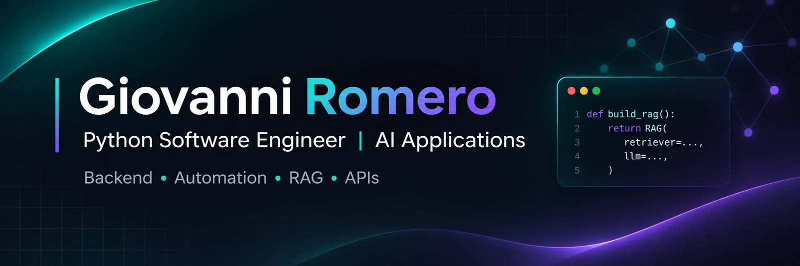

  

**Building practical software with Python, applied AI, and automation.**

## About me

I'm **Giovanni**, a Brazilian software developer based in **Germany**. Over the past three years, I've built internal tools and applications for everyday business operations, combining my background in industrial technology with a growing focus on **Python backend development and applied AI**.

I enjoy taking an idea from a real-world problem to working software: designing APIs, automating processes, integrating data, and experimenting with retrieval-augmented generation (RAG).

- **Current focus:** Python engineering, LLM applications, RAG, automation, and reliable backend services
- **Engineering approach:** clear architecture, testing, maintainability, and practical results
- **Education:** Bachelor's degree in Computer Science (in progress)
- **Languages:** Portuguese · German · English

## Tech stack

## Featured projects

### [Divan](https://gio-website-sage.vercel.app/#divan-roundtable) · Applied AI / RAG
A psychology-focused assistant that retrieves information from reference books to support context-grounded answers. Its portfolio demo illustrates how a fictional case can be explored from multiple theoretical perspectives.

**[Explore the interactive portfolio demo](https://gio-website-sage.vercel.app/#divan-roundtable)** · Private repository

### [SwingTrade](https://gio-website-sage.vercel.app/#st-replay) · Python / Automation
A research and automation project for crypto trading strategies, built around market signals, risk-management rules, and repeatable testing. The portfolio includes an **illustrative historical-candle walkthrough**, not a live trading or performance report.

**[See the strategy walkthrough](https://gio-website-sage.vercel.app/#st-replay)** · Private repository

### [TubeReel](https://github.com/Giovanni-Romero/Tubereel) · AI / Video Automation
An AI-assisted pipeline that turns long-form videos into short clips: analysis, selection, captions, vertical formatting, and a human review step before publishing.

**[Source code](https://github.com/Giovanni-Romero/Tubereel)** · **[See the workflow demo](https://gio-website-sage.vercel.app/#tr-pipeline)**

### [CodeQuest](https://github.com/Giovanni-Romero/Codequest) · Python / Developer Education
An offline-first coding adventure that teaches Python through story-driven missions, built-in lessons, an executable code judge, and an optional local AI mentor.

**[Source code](https://github.com/Giovanni-Romero/Codequest)** · **[Try the browser mission preview](https://gio-website-sage.vercel.app/#codequest-demo)**

## Let's connect

Interested in Python, backend engineering, applied AI, or a possible collaboration? You can browse my work on my website or reach out through LinkedIn.

**[Personal website / Portfolio](https://gio-website-sage.vercel.app/)** · **[LinkedIn](https://www.linkedin.com/in/giovanni-romero-de-paula-0a7335251/)** · **[GitHub](https://github.com/Giovanni-Romero)**

From industrial technology to intelligent software.

