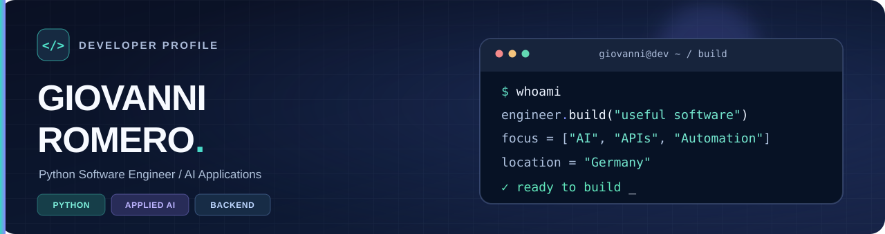

<p align="center">
  
</p>

<div align="center">

### Building practical software at the intersection of Python, AI and automation.

[](https://gio-website-sage.vercel.app)
[](https://www.linkedin.com/in/giovanni-romero-de-paula-0a7335251/)
[](https://github.com/Giovanni-Romero)

</div>

---

## 👋 A little about me

I'm **Giovanni**, a Brazil-born software developer based in **Germany**, focused on **Python backend engineering, applied AI and developer automation**.

My background combines hands-on software development with years of experience in industrial technology and complex technical environments. I enjoy turning real-world problems into **clear, maintainable software** — especially when APIs, data pipelines and language models can make workflows simpler.

- 🧠 **AI engineering:** LLM applications, RAG, retrieval pipelines and AI-assisted workflows
- ⚙️ **Software engineering:** Python, backend APIs, asynchronous processing and automated testing
- 🔧 **Systems mindset:** automation, structured data, integration and reliability
- 🎓 **Learning:** pursuing a Bachelor's degree in Computer Science
- 🌍 **Languages:** Portuguese, German and English

## 🛠️ Tech stack

<div align="center">


</div>

## 🚀 Selected projects

| Project | What it does | Access |
| :--- | :--- | :--- |
| **[CodeQuest](https://github.com/Giovanni-Romero/Codequest)** | An offline-first Python learning adventure with coding missions, an executable judge and an optional AI mentor. | **Public repo** |
| **[TubeReel](https://github.com/Giovanni-Romero/Tubereel)** | An AI-assisted video automation pipeline, from clip selection and subtitles to review and publishing workflows. | **Public repo** |
| **Divan** | A retrieval-augmented assistant designed to search psychology reference books and produce grounded answers. | Private project |
| **SwingTrade** | A Python-based trading research and automation system with risk rules, testing and strategy evaluation. | Private project |

> **Public code and live demos:** explore [my repositories](https://github.com/Giovanni-Romero?tab=repositories) or visit [my portfolio](https://gio-website-sage.vercel.app).

## 🔍 Areas I'm exploring

```text
Python backend     →  API design, async workflows, reliable services
Applied AI         →  RAG, LLM orchestration, local models
Automation         →  data pipelines, agents, repeatable workflows
Software quality   →  TDD, observability, maintainability
```

## 🤝 Let's connect

I'm interested in **Python engineering, applied AI, backend systems and meaningful technical collaborations**.

If you want to see what I'm building or reach out about a project, the best starting point is my **[portfolio](https://gio-website-sage.vercel.app)**. You can also find me on **[LinkedIn](https://www.linkedin.com/in/giovanni-romero-de-paula-0a7335251/)**.

<div align="center">

<sub>From industrial technology to intelligent software · Built with curiosity and a practical engineering mindset.</sub>

</div>